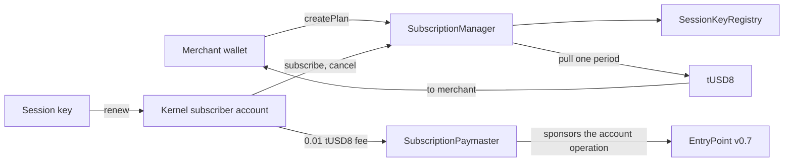

# RenewPay

## Problem

A merchant selling a seat, a membership, or API access needs the next tUSD8 charge to happen without a new unlimited approval every period. The subscriber needs a cap, an expiry, and a way to stop the next charge. They should see the exact amount, the period, the recipient, and the cap before the wallet signs.

## Architecture



QDay’s paymaster at `0x8DdF5E51c470257642e2c17E43977901b1173eFa` does not sponsor `SubscriptionManager`. The checkout deploys `SubscriptionPaymaster` and `RenewOnlyPolicy` when the funded wallet confirms those transactions. Until then, those two contracts are not on chain.

## Safety model

- The allowance is `cap × 2` for the manager, plus `0.1` tUSD8 for the paymaster fee. The checkout refuses `type(uint256).max`. The manager reverts `UnlimitedAllowance` if it sees one.
- The plan price is copied onto the subscription. No function edits a live price.
- A renewal pays only if the key is active, the period is due, the price is within the cap, and the balance and allowance cover it.
- Pause and revoke calls `cancelSubscription`, which revokes the session key. The manager cannot set the ERC-20 allowance to 0, so the same click does that from the subscriber account. The paymaster allowance is set to the 0.01 tUSD8 fee and that fee spends it down to 0.
- The session key can call renew, and a finite manager top-up in that same operation. It cannot transfer tUSD8 elsewhere. Subscribe and cancel stay on the owner wallet.
- The first renewal asks the owner to approve that permission. Later renewals are signed by the key.

## Live addresses

| | |
| --- | --- |
| Chain | QDay Aevum testnet, id 44005 |
| tUSD8 | `0x456569838f1d43009A91ebA4263147Afd7233483` |
| SubscriptionManager | `0x51202A87aFdc07085e9586bc5E30a81a8cC4ff13` |
| SessionKeyRegistry | `0x5fB5817ABb539C8628b45c0C0eC95797D2C85F26` |
| EntryPoint v0.7 | `0x0000000071727De22E5E9d8BAf0edAc6f37da032` |
| Explorer | https://explorer-test.qday.info |
| Checkout | https://renewpay-checkout.apps.grok.bot |

`SubscriptionPaymaster` and `RenewOnlyPolicy` have no fixed address until the wallet deploys them from Subscriber.

## Environment

Copy `.env.example` to `.env` for the CLI. Leave the private keys empty in git. The checkout does not read `.env`. It uses the live addresses above.

```text
RPC_URL=https://rpc-test.qday.info
DEPLOYER_PRIVATE_KEY=
SUBSCRIBER_PRIVATE_KEY=
TUSD8_ADDRESS=0x456569838f1d43009A91ebA4263147Afd7233483
SUBSCRIPTION_MANAGER_ADDRESS=
SESSION_KEY_REGISTRY_ADDRESS=
```

## Three-minute demo

Open https://renewpay-checkout.apps.grok.bot with wallet `0xCDB8793ec57DcdcC432CA083792dE9fb78d46750`. Deploy the renew policy, the paymaster, and the 0.05 tQDAY fund before you start if those buttons are still waiting.

1. “This is a tUSD8 subscription. The price is fixed when the plan is created.” Create the plan.
2. “Read the review: 1 tUSD8, every 2 minutes, paid to this merchant, cap 2 tUSD8.” Sign the subscription. Point at the receipt link.
3. “The network fee on that call was 0.01 tUSD8. QDay’s paymaster does not sponsor this manager. This paymaster does, after you deploy it.”
4. On Merchant, point at the next-due time and at the signed event from `/api/events`. The HMAC secret stays on the server. When the timer hits zero, leave the page open. The keeper renews. The session key signs it. The explorer link appears without a Renew click.
5. “Pause and revoke stops the next charge and sets the allowance to 0. The manager cannot zero the allowance, so the subscriber account does it in this click.” Then show why a renewal stops.

RenewPay is a subscription billing contract for QDay Aevum. A merchant publishes a tUSD8 plan. A subscriber authorizes a session key with a per-period spending cap and an expiry. The first period is collected on subscribe (unless the plan has a trial). Anyone can call `renewSubscription` once the next period is due. Only the subscriber can cancel, and cancellation revokes the session key.

The contracts and the Node CLI are the week-1 core. The `web` checkout is the merchant and subscriber UI. Subscribe, renew, and cancel are ERC-4337 UserOperations. Their network fee is 0.01 tUSD8, paid to a paymaster the checkout deploys. The subscription payment is tUSD8. The session key signs renewals. Webhook delivery is not part of this checkout.

## Chain

| | |
| --- | --- |
| Network | QDay Aevum Testnet |
| Chain ID | 44005 (`0xABE5`) |
| RPC | https://rpc-test.qday.info |
| WebSocket | wss://rpc-test.qday.info |
| Explorer | https://explorer-test.qday.info |
| Native gas token | tQDAY, 18 decimals |

These are the Aevum endpoints published by QDay (https://qday.io/build and https://qday.io/official-links). `eth_chainId` on the RPC returns `0xabe5`.

## Settlement token

tUSD8 `0x456569838f1d43009A91ebA4263147Afd7233483`, 6 decimals.

The core flow uses this token only. On chain id 44005 the manager rejects any other token address. `SubscriptionManager` never calls `approve`. An allowance of `type(uint256).max` is rejected. The CLI approves `spendingCapPerPeriod * periodsUntilExpiry`, which is finite.

A plain local Anvil node is not Aevum, so it has no tUSD8. `npm run renewpay -- deploy` deploys a 6-decimal mock there and only there. An Anvil fork of Aevum keeps chain id 44005 and uses the real token.

## Contracts

`createPlan(amount, periodSeconds, trialSeconds, metadataURI)` stores a plan. `trialSeconds = 0` means no trial. The plan id is

```text
keccak256(abi.encode(merchant, amount, periodSeconds, trialSeconds, keccak256(bytes(metadataURI))))
```

The same merchant and the same terms always produce the same id.

`subscribe(planId, sessionKey, spendingCapPerPeriod, expiry)` records the session key in `SessionKeyRegistry` and snapshots `amount` and `periodSeconds` onto the subscription. There is no function that edits a plan or a live price.

`renewSubscription(subscriptionId)` is permissionless. It collects one period of the snapshotted amount when all of these hold:

- the subscription is not cancelled
- the session key is registered, not revoked, and not expired
- the period is due
- the snapshotted amount does not exceed the per-period cap
- the subscriber's tUSD8 balance and finite allowance both cover the amount

A failed check reverts with a named error. On the renewal path the contract emits `RenewalFailed` before reverting. The EVM drops logs when a transaction reverts, so the durable signal is the custom error (`SubscriptionIsCancelled`, `SessionKeyInactive`, `SessionKeyExpired`, `PeriodNotDue`, `CapExceeded`, `InsufficientBalance`, `InsufficientAllowance`, `UnlimitedAllowance`).

`cancelSubscription(subscriptionId)` is subscriber-only. It revokes the session key.

Week 1 stores the session key address. It does not validate ERC-4337 signatures, and it does not submit UserOperations to a paymaster.

## Contract addresses

These contracts are live on Aevum. The checkout calls them. Do not redeploy over them.

The live manager was compiled for the Paris EVM. `foundry.toml` still uses Cancun for local tests. A new broadcast from this repo would be a different deployment, and the checkout would not follow it.

| Contract | Address |
| --- | --- |
| SubscriptionManager | [`0x51202A87aFdc07085e9586bc5E30a81a8cC4ff13`](https://explorer-test.qday.info/address/0x51202A87aFdc07085e9586bc5E30a81a8cC4ff13) |
| SessionKeyRegistry | [`0x5fB5817ABb539C8628b45c0C0eC95797D2C85F26`](https://explorer-test.qday.info/address/0x5fB5817ABb539C8628b45c0C0eC95797D2C85F26) |
| tUSD8 | [`0x456569838f1d43009A91ebA4263147Afd7233483`](https://explorer-test.qday.info/address/0x456569838f1d43009A91ebA4263147Afd7233483) |
| EntryPoint v0.7 | [`0x0000000071727De22E5E9d8BAf0edAc6f37da032`](https://explorer-test.qday.info/address/0x0000000071727De22E5E9d8BAf0edAc6f37da032) |
| Stablecoin paymaster | [`0x8DdF5E51c470257642e2c17E43977901b1173eFa`](https://explorer-test.qday.info/address/0x8DdF5E51c470257642e2c17E43977901b1173eFa) |

Bundler: `https://bundler.qday.info`. It accepts EntryPoint v0.7.

The subscriber account is Kernel v3.1. On Aevum the meta factory is [`0x007Cb4A07296B53eA5e53d043888230797B8FD01`](https://explorer-test.qday.info/address/0x007Cb4A07296B53eA5e53d043888230797B8FD01), the Kernel factory is [`0xaac5D4240AF87249B3f71BC8E4A2cae074A3E419`](https://explorer-test.qday.info/address/0xaac5D4240AF87249B3f71BC8E4A2cae074A3E419), and the ECDSA validator is [`0x845ADb2C711129d4f3966735eD98a9F09fC4cE57`](https://explorer-test.qday.info/address/0x845ADb2C711129d4f3966735eD98a9F09fC4cE57). The ZeroDev meta factory `0xd703aaE79538628d27099B8c4f621bE4CCd142d5` has no code on this chain.

## Checkout

```bash
cd web
npm install
npm test
npm run dev
```

Open the printed local URL and connect a wallet on chain id 44005. The page can add the network. It never asks for a private key.

The live checkout is https://renewpay-checkout.apps.grok.bot. Use that for the steps below. The signed webhook inbox stays on your machine. The public page does not call it.

### Demo steps

Use wallet `0xCDB8793ec57DcdcC432CA083792dE9fb78d46750`. It holds the demo tUSD8 and the tQDAY for the deploys. One wallet is both merchant and subscriber: the subscriber is the Kernel account derived from it.

1. Connect that wallet.
2. On Subscriber, click **Deploy renew policy**, then **Deploy paymaster**, then **Fund paymaster**. Confirm each. The fund is 0.05 tQDAY. A quarter of it is staked with the EntryPoint. The rest is the paymaster's float.
3. On Merchant, leave the form at 1 tUSD8 and 120 seconds. Click **Create plan** and confirm. The fee is tQDAY.
4. Open Subscriber. The 3 tUSD8 is already on the account. Click **Subscribe** and confirm. The 1 tUSD8 moves to the merchant. The network fee is 0.01 tUSD8.
5. When the timer hits zero, click **Renew**. The first time, the wallet approves the session key. The key signs the UserOperation. Another 1 tUSD8 moves, and another 0.01 tUSD8 pays the fee.
6. Click **Cancel**, then **Show why a renewal stops**. The revert is `SubscriptionIsCancelled`.

Aevum has no time warp. The form defaults to 120 seconds so a renewal fits in one sitting. The 30-day preset is the monthly plan. Trial defaults to 0, so subscribe pulls the first period. The spending cap stays 2 tUSD8 (`2000000` base units).

History reads are split into 1,000-block `eth_getLogs` windows. Aevum rejects a wider range.

### Signed inbox

```bash
cd web
npm run webhook
```

In another terminal, `npm run dev` and use the local page. The dev server forwards `/inbox` to the webhook process and adds the secret itself, so the browser never talks to port 8787 and the secret is not in the page. The inbox verifies `x-qday-signature` (HMAC-SHA256 of the raw JSON body) and stores deliveries in `web/.webhook/inbox.sqlite`. Reading the inbox requires that same secret. The HMAC secret is created on first run at `web/.webhook/secret`. The process watches public logs and simulates `renewSubscription` after cancel. It does not send transactions and it does not read a private key. A request body larger than 16 KiB is refused before the signature check.

The subscriber account is a counterfactual Kernel account owned by the connected wallet. Move tUSD8 onto that account before subscribing. That transfer is a normal wallet transaction, so its fee is tQDAY. A single faucet claim is 5 tUSD8, and the form defaults the move to 3 tUSD8: one subscribe and one renewal.

Subscribe, renew, and cancel are UserOperations sent to `https://bundler.qday.info`. QDay’s stablecoin paymaster at `0x8DdF5E51c470257642e2c17E43977901b1173eFa` reverts `validatePaymasterUserOp` unless the call is a plain tUSD8 transfer or a call to its identity registry `0xf45e7f39caba1d2055f613970575a7e7069636be`. It has no allowlist function, so the checkout deploys `SubscriptionPaymaster` instead. That contract sponsors only subscribe, renew, cancel, and the finite tUSD8 approvals those calls need. After the call it pulls 0.01 tUSD8 (`10000` base units) from the subscriber. The EntryPoint still spends tQDAY, from the paymaster's own deposit. The subscription pull is still tUSD8. The UserOperation approves two finite amounts:

- `cap × 2` to `SubscriptionManager`: the first charge and one renewal, even when the session key expires in 365 days. A 2-minute period no longer pre-approves a year of pulls. A later renewal tops the allowance back up to that same finite amount only when the remainder cannot cover another period. The manager rejects `type(uint256).max`. The renew policy rejects an approval above 20 tUSD8 (`20000000`).
- `100000` (0.1 tUSD8) to the paymaster, which covers ten network fees.

The session key is a private key kept in this browser, never in the repository. Subscribe registers its address. The first renewal asks the owner to approve a Kernel permission: the key may call `execute`, and `RenewOnlyPolicy` allows only `renewSubscription` plus that finite manager approval. The key signs the UserOperation. Later renewals do not ask the wallet again. Cancel stays on the owner wallet and revokes the key in the registry. The ECDSA signer module is the one already on Aevum, `0x6A6F069E2a08c2468e7724Ab3250CdBFBA14D4FF`. The root validator is not replaced.

`createPlan` stays a merchant wallet transaction. Its fee is tQDAY. The merchant view lists plans, subscriptions, and renewal logs from the live manager. `npm run webhook` is the signed inbox described above.

## Test

Clone with submodules so `lib/forge-std` is present (`git clone --recurse-submodules`). Then:

```bash
forge test
```

The suite covers plan creation, subscribe (including the first tUSD8 pull), renewal inside the cap, renewal over the cap, cancel then renew, and renewal after session-key expiry.

## CLI against local Anvil

```bash
cd cli
npm install
```

In another shell, start Anvil. Copy `.env.example` to `.env` at the repo root. Point `RPC_URL` at `http://127.0.0.1:8545`, and set `DEPLOYER_PRIVATE_KEY` and `SUBSCRIBER_PRIVATE_KEY` to two local Anvil accounts. Do not commit `.env`.

```bash
npm run renewpay -- deploy
npm run renewpay -- create-plan --amount 9990000 --period-seconds 2592000 --trial-seconds 0 --metadata ipfs://renewpay/pro
npm run renewpay -- subscribe --plan-id <planId> --session-key <address> --cap 10000000
npm run renewpay -- renew --subscription-id <subscriptionId> --warp-seconds 2592000
```

`9990000` is 9.99 tUSD8. `10000000` is a 10 tUSD8 cap. `2592000` is a 30-day period. `--expiry` defaults to 365 days from the latest block. `--warp-seconds` moves time on a local node and is refused on chain id 44005. The Aevum checkout uses a smaller demo, 1 tUSD8 and a 2 tUSD8 cap, because one faucet claim is 5 tUSD8. The CLI commands above stay the local Anvil example, and they pay gas in the node's native token.

`deploy` writes `deployments/latest.json` (gitignored). Later commands read that file when the address env vars are empty.

## Deploy to Aevum

The addresses in the table above are the live deployment. The checkout uses those addresses. A new broadcast creates a different pair of contracts.

```bash
forge script script/Deploy.s.sol \
  --rpc-url https://rpc-test.qday.info \
  --private-key "$DEPLOYER_PRIVATE_KEY" \
  --broadcast
```

The CLI does the same thing when `RPC_URL` is the Aevum RPC:

```bash
cd cli
npm run renewpay -- deploy
```

On Aevum the token is fixed to tUSD8. The deployer needs tQDAY for gas. Subscribers need tUSD8 from the Aevum faucet (https://faucet.qday.info/en) before `subscribe`.

After a broadcast, verify on the Blockscout API. `SubscriptionManager`'s constructor arguments are the tUSD8 address and the registry address.

```bash
forge verify-contract \
  --chain-id 44005 \
  --verifier blockscout \
  --verifier-url https://explorer-test.qday.info/api \
  --constructor-args $(cast abi-encode "constructor(address,address)" 0x456569838f1d43009A91ebA4263147Afd7233483 <REGISTRY>) \
  <MANAGER> src/SubscriptionManager.sol:SubscriptionManager

forge verify-contract \
  --chain-id 44005 \
  --verifier blockscout \
  --verifier-url https://explorer-test.qday.info/api \
  <REGISTRY> src/SessionKeyRegistry.sol:SessionKeyRegistry
```

The table above already lists the live deployment. A new broadcast does not replace those addresses.

## Assumptions

See [SECURITY.md](SECURITY.md).